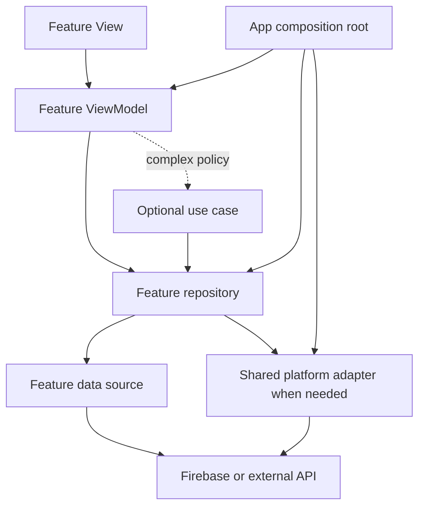

# CMU SBNU Flutter Architecture

**Purpose:** Development architecture for the proposed CMU–SBNU Volunteer Management System. Use this document to organize Flutter code and review technical decisions before implementation.

**Status:** Proposed for technical, privacy, and safety review. This document describes a recommended structure; it does not mean features, Firebase services, security controls, or institutional approvals are complete. Requirements in the [specification Markdown set](specification/README.md) remain authoritative where this architecture is silent.

## 1. Architecture decision

Build a **feature-first modular monolith**: one Flutter app and one Dart package, divided into the system's business capabilities. Use a practical MVVM structure inside each feature:

- **View:** Flutter widgets display state and forward user actions.
- **ViewModel:** owns the state and commands for a screen or cohesive UI flow.
- **Repository:** source of truth for a feature's data; coordinates sources, maps data, handles retry/cache policy, and translates errors.
- **Data source/service:** a small adapter around one external source such as Firebase Auth, Firestore, a callable Function, or a platform plugin.
- **Application/domain logic:** add only for complex lifecycle rules, reusable policy, or a workflow that coordinates multiple repositories.

This project has simple CRUD/read flows alongside unusually sensitive and rule-heavy workflows. A hotline directory screen does not need a use case for every repository method. QR attendance, role changes, incident review, SOS routing, and sensitive exports do need explicit policy and/or orchestration. Flutter's architecture guidance recommends Views, ViewModels, Repositories, and Services, and treats a domain/use-case layer as optional when complexity warrants it ([Flutter app architecture guide](https://docs.flutter.dev/app-architecture/guide)).

Do not split features into separate Dart packages at this stage. Keep boundaries enforceable through folder ownership, public APIs, code review, and tests. Consider separate packages only when independent teams, reuse across apps, or build constraints make the extra dependency management worthwhile.

## 2. Scope and constraints

The client architecture covers the planned Flutter app for volunteers and authorized unit staff. The planning baseline proposes Firebase Authentication and Cloud Firestore, with trusted server operations for privileged or atomic workflows. Confirm the Firebase products, platform support, region, cost, maps, notifications, and backend runtime before production design.

The app is not public emergency dispatch. Do not represent alert delivery as guaranteed or the app as a replacement for local emergency procedures. Continuous background location and SMS dispatch are outside the proposed first release. Production SOS is gated on named responders, operating coverage, escalation/fallback procedures, training, and simulation.

## 3. Feature ownership

Keep these modules separate because they have distinct records, life cycles, and access rules.

| Module | Owns | Key boundaries |
| --- | --- | --- |
| `auth` | Registration/sign-in/recovery and authenticated identity/session stream | Authentication proves identity; it does not decide authorization. |
| `access_control` | Account approval/status, roles, scoped designations, account administration | No self-promotion. Sensitive role changes use a trusted operation and audit. |
| `organizations` | Organization hierarchy, membership, coordinator assignment | Membership and hierarchy changes are scoped and privileged. |
| `volunteers` | Volunteer profile, roster, profile approval views | Profile fields have an explicit self-edit allowlist and privacy classification. |
| `activities` | Activity lifecycle, browse/detail, participation requests and decisions | Participation is distinct from attendance. |
| `attendance` | Attendance entry/history/correction and QR-assisted attendance | QR creates attendance; server validates activity, eligibility, token/time, replay, and idempotency. |
| `announcements` | Authoring, audience selection, publish/archive, member feed | Audience scope and publisher designation are checked on trusted boundaries. |
| `incidents` | User-initiated reports, review, assignment, history, restricted map/list | Location is optional; reporter identity/narrative do not appear in map markers. |
| `sos` | Deliberate alert submission, delivery state, designated responder queue, updates | SOS lifecycle and delivery state are separate; recipient routing is never a broad broadcast. |
| `hotlines` | Directory, institutional verification/expiry, call handoff | Only current verified entries can call; handoff requires user confirmation. |
| `reporting` | Scoped operational analytics and bounded export jobs | Export scope, fields, expiry, and audit are explicit. |
| `audit` | Restricted review of append-only audit events | Audit records are not general-purpose analytics or editable feature history. |

### Cross-feature ownership rules

- `organizations` owns organization identity and membership. `volunteers` may display membership but must not privately rewrite organization hierarchy.
- `activities` owns participation; `attendance` owns attendance events and corrections.
- `incidents`, `sos`, and `hotlines` remain separate despite their safety relationship. Share low-level platform adapters only; keep authorization and workflow policy local.
- `auth` owns the identity/session stream. `access_control` owns the current account status and scoped permission profile. App routing may combine them for navigation, but every protected data operation is still authorized by Rules or the trusted backend.
- `reporting` consumes approved read/query contracts; it does not reach into another feature's repository implementation. `audit` reads only its restricted audit records.

## 4. Source layout

The current scaffold intentionally contains only module roots. Add source folders as each module is implemented; avoid empty layer boilerplate.

```text
lib/
├── main.dart                         # Startup entry only
├── app.dart                          # Root app and router composition
├── firebase_options.dart             # Generated client options; not server secrets
├── app/
│   ├── bootstrap/                    # Initialize bindings/Firebase and select environment
│   ├── dependencies/                 # Provider composition root
│   ├── routing/                      # GoRouter routes and UX-level redirects
│   └── theme/                        # Theme, typography, color/spacing tokens
├── core/
│   ├── errors/                       # Safe typed failures shared across features
│   ├── logging/                      # Privacy-safe logging interface/configuration
│   ├── platform/                     # Low-level adapters only after shared use exists
│   └── types/                        # Stable generic primitives, only when needed
├── shared/
│   └── presentation/                 # Reused policy-free UI (forms, states, widgets)
└── features/
    ├── auth/
    ├── access_control/
    ├── organizations/
    ├── volunteers/
    ├── activities/
    ├── attendance/
    ├── announcements/
    ├── incidents/
    ├── sos/
    ├── hotlines/
    ├── reporting/
    └── audit/
```

A simple feature can start with:

```text
features/<feature>/
├── presentation/
│   ├── pages/
│   ├── view_models/
│   └── widgets/
└── data/
    ├── <feature>_repository.dart     # Feature data API/source of truth
    ├── sources/                      # Firebase/platform adapters
    └── models/                       # DTOs and mapping, if needed
```

Add `application/` or `domain/` when useful. For example, a complex SOS module may grow to:

```text
features/sos/
├── presentation/                     # Confirm screen, responder inbox, ViewModels
├── application/                      # Create/acknowledge/update use cases
├── domain/                           # Alert lifecycle policy and repository contract
└── data/                             # Repository implementation, DTOs, callable source
```

Keep files near the feature that owns them. Avoid both a single `screens/` directory for the whole app and generic `models/`, `services/`, or `utils/` dumping grounds.

## 5. Shared code, services, and dependencies

### What is shared

| Code | Location | Rule |
| --- | --- | --- |
| App startup, routing, theme, dependency construction | `app/` | Composition only; no feature business policy. |
| Cross-cutting safe failures, logging, stable primitive types | `core/` | Must not import a feature. Keep APIs small. |
| Reusable forms, loading/empty/error states, basic widgets | `shared/presentation/` | Accept state/callbacks; never fetch data or authorize actions. |
| Stateless wrappers reused for platform APIs | `core/platform/` | Extract only after at least two real feature consumers exist. Keep purpose/consent/policy in each feature. |
| Firebase queries, callable contracts, feature DTO mapping | Owning feature `data/sources/` | Keep document paths and authorization-sensitive query assumptions visible to reviewers. |
| Stateful data shared across screens | Owning feature repository | Example: auth owns the session stream. Expose a small public API; do not add a parallel global session singleton. |
| One-feature integration | Owning feature | QR scanner stays in attendance; phone dialer handoff stays in hotlines. |

Avoid catch-all `FirebaseService`, `ApiService`, `AppService`, and mutable global `AppState`. A repository may use multiple data sources, and a stateless platform adapter may be used by multiple repositories. Wire shared instances in `app/dependencies/`. Repositories must not depend on other repositories. A workflow that combines repositories belongs in its ViewModel if simple or in a feature use case if complex.

### Dependency direction



- Views depend on ViewModels, not repositories or Firebase.
- ViewModels depend on feature repositories and, where needed, use cases. They expose UI-ready state and actions; they do not own Firestore paths, serialization, or security policy.
- Repository implementations coordinate data sources, map DTOs to app models, and translate backend failures into safe typed failures.
- Data sources wrap external APIs and hold no business state.
- Use cases depend on repository contracts and pure policy, never on widgets or Firebase SDK objects.
- The app composition root may import feature implementations to construct them. Shared/core code must not import features.
- One feature may use another feature only through a documented public contract. Avoid cycles and imports of another feature's internal data source or widget.

### State management and navigation

The package currently declares `provider` and `go_router`. Recommended baseline: `ChangeNotifier`-based ViewModels exposed through Provider, and GoRouter for route composition. This is a project choice to confirm in technical design, not a claim that packages are already integrated.

- Pair each screen/cohesive view with its own ViewModel; split ViewModels when responsibilities or lifetimes differ.
- Expose immutable UI state (loading, data, empty, validation, permission denied, offline/unknown, retryable error) and command methods.
- Keep route guards as navigation guidance only. They must not be treated as authorization.
- Scope screen ViewModels to route/feature lifecycle; dispose subscriptions and cancel work when their owner is disposed.
- Avoid global mutable state; keep shared state in the owning repository and expose it through Provider.

## 6. Firebase and authorization boundaries

Use Firebase Auth and Firestore client SDKs for ordinary client access only when reviewed Firestore Rules can fully validate the operation. Firebase recommends Auth and Rules for mobile/web access and IAM for privileged server libraries ([Firestore security overview](https://firebase.google.com/docs/firestore/security/overview)).

| Operation | Preferred boundary | Required safeguards |
| --- | --- | --- |
| Read an approved public/audience-scoped list | Feature repository → Firestore source | Query bounds, pagination, matching Rules, indexes. Rules do not filter an unauthorized broad query. |
| Read/update own profile fields | Feature repository → Firestore source where Rules can enforce | Authenticated UID match, explicit editable-field allowlist, type/size checks. |
| Request activity participation | Direct write or trusted operation after review | Eligibility, state transition, organization/activity scope, duplicate prevention. |
| Record/repair attendance | Trusted operation for QR and privileged corrections | Activity assignment, eligibility, idempotency, correction reason, audit. |
| QR session issue/scan | Trusted callable operation | Server time, short validity, signed/opaque token, replay protection, activity binding. Never expose signing secrets. |
| Incident submit/review | Direct submit only if Rules fully validate; reviewer transitions through trusted operation where atomic/sensitive | Optional location, scoped visibility, bounded payload, expected-version/conflict handling, append-only history. |
| Create/route/acknowledge/update SOS | Trusted backend operation | Deliberate confirmation, idempotency, active responder designation, recipient resolution, rate limits, truthful delivery state, audit. |
| Verify hotline or change access/role | Trusted backend operation | Separation of duties, current approver authority, second approver where approved, audit. |
| Sensitive report/export | Trusted scoped job/operation | Organization/date/query bounds, field allowlist, expiry, download access, audit. |

The backend may use Cloud Functions as proposed in the planning package, but its runtime and deployment layout are not chosen. Keep backend source outside `lib/`; decide and document the server project before building callable contracts. Admin SDK calls bypass Firestore Rules, so each privileged function must validate identity, current account state, scope, payload, legal transition, rate limit, and audit behavior itself, and run with least-privilege IAM.

### Data and serialization

- Firestore document names, field names, indexes, and query semantics are part of a reviewed data contract. Keep them in the owning feature's data layer.
- Use explicit Firestore DTOs and mappers for timestamps, references, enum values, optional location, and server-managed fields. Do not pass raw `DocumentSnapshot` objects into widgets or domain policy.
- Use server-authoritative timestamps and bounded records. Put growing history in subcollections/collections, not arrays on a single document.
- Separate user-editable fields from server-managed fields. Reject unknown or disallowed fields at a trusted boundary.
- Do not create generic schema helpers until repeated mapping conventions are proven; do share small timestamp/ID converters if multiple features need identical behavior.

### Offline, retry, and error behavior

- Decide offline support per feature. Ordinary cached reads may be available; queued writes must show pending/sync state and conflict behavior.
- SOS must never be queued silently or shown as submitted when no server acceptance exists. Offer the approved verified-hotline fallback on failure.
- Reuse a request/idempotency key for safe retries of create/update operations. Do not retry permission-denied or invalid requests automatically.
- Map backend error codes (unauthenticated, permission-denied, invalid-argument, not-found, failed-precondition, resource-exhausted, unavailable, internal) into safe UI messages and structured logs.
- Keep exact location, incident narratives, tokens, passwords, hotline verification material, and personal details out of logs and broad caches.

## 7. Workflow-specific architecture requirements

### Identity, organizations, and access control

Represent authentication identity separately from account status, organization membership, and operational designation. The client may subscribe to a session/access profile for menus and route UX, but the trusted boundary must check current active status and scoped designation for each sensitive request. Prevent self-grant and self-escalation in backend workflows.

### Attendance and QR

Participation is not attendance. Store attendance under the approved activity/user relationship; history queries must be bounded and indexed. QR scanning is a presentation input only. A trusted operation validates eligibility, token/session signature and expiry, activity binding, server time, replay/idempotency, and records one attendance event. Corrections require a reason, authorized activity scope, before/after evidence, and audit.

### Incidents and maps

A report remains possible without location. Store a clear `locationShared`/optional-location state; never use sentinel coordinates. Scope detail access to the reporter and authorized reviewers. Map markers show only approved/approximate coordinates and safe status/category fields; keep a list alternative for accessibility and map failure. Lifecycle transitions and history are validated and appended through authorized operations.

### SOS and responder operations

The user sees recipients and shared data before deliberate confirmation. Create an idempotent alert and route notice only to the active, designated roster. Keep alert lifecycle (`submitted`, `acknowledged`, `actionInProgress`, etc.) separate from delivery state (`pending`, `sent`, `failed`, `unknown`). Provider acceptance does not mean a responder saw the message. Do not enable production SOS until responder coverage, escalation, offline fallback, training, and a simulation have written approval.

### Hotlines, announcements, reporting, and audit

Only institution-verified, current hotline entries enable call handoff. Announcements are scoped to an approved audience. Reports are bounded and organization-scoped; exports have expiry and audited access. Audit events are append-only and contain only minimum metadata needed for accountability.

## 8. Environments, observability, and release

- **Current repository baseline:** `firestore.rules` denies all client reads/writes until reviewed rules are added. Treat that as intentional. The repo has no selected/deployed Functions environment, and dependency presence alone does not mean a Firebase environment is configured.
- **Declared Flutter packages:** `firebase_core`, `firebase_auth`, and `cloud_firestore` provide the current Firebase client baseline; `provider` and `go_router` are the proposed state/navigation baseline; `connectivity_plus`, `mobile_scanner`, `shared_preferences`, `intl`, and `crypto` are also declared. Use each only where an approved feature needs it.
- **Not yet in the declared client dependencies:** callable Functions and push notification clients, plus location/map integrations. Confirm each provider, platform support, privacy implications, cost, and security design before adding packages. Do not assume a map or emergency push integration is already selected.
- Use separate local/emulator, staging, and production Firebase projects/configurations; use synthetic data outside approved production.
- Keep `firebase_options.dart` generated for client configuration. Never include Admin SDK/service-account credentials in Flutter assets, source, or bundles.
- Write Security Rules and indexes alongside each feature's data access; test the intended query against its Rules before integration.
- Use Firebase Emulator Suite where applicable for Auth/Firestore/Functions and Rules workflows. Define CI checks and protected production deployment before pilot.
- Log event names, environment, app version, request/correlation ID, and safe failure code. Exclude private narrative, exact location, secrets, and unnecessary identifiers.
- Define monitoring ownership, backup/restore, support, access review, incident response, and rollback before live data.
- Confirm target platforms and capability support (location, scanner, notifications, dialer) before finalizing plugins or platform-specific code.

## 9. Verification structure

Keep the existing root `test/` directory and organize future verification by boundary:

```text
test/
├── unit/features/<feature>/           # ViewModel, policy, use-case, mapper behavior
├── widget/features/<feature>/         # Screen states and user-visible behavior
├── integration/features/<feature>/    # Firebase emulator workflows
└── security/                           # Rules and authorization allow/deny cases
```

Critical negative cases include self-role elevation, cross-organization reads, stale/suspended accounts, unauthorized responder access, forged/replayed QR, duplicate submissions, stale incident versions, unverified hotline calls, and unscoped exports. Test SOS network failure and unknown delivery states. This is the proposed test layout; tests must be added as features are implemented.

## 10. Development sequence and gates

| Step | Build focus | Exit condition |
| --- | --- | --- |
| 0. Decisions | Confirm first-release scope, platform targets, role/action matrix, Firebase environment/region, architecture/state-management choice, privacy/safety owners. | Decisions and owners are recorded; open questions blocking schema or auth are resolved. |
| 1. Foundation | Bootstrap, environment config, Provider composition, routing, theme, error/logging approach, emulator setup. | App starts in local environment; no production secrets are bundled; baseline route/session behavior is agreed. |
| 2. Identity and organization | Auth, account lifecycle, organizations/membership, role/designation admin and audit path. | Rules/functions and positive/negative role tests demonstrate least privilege. |
| 3. Operations | Volunteers, activities, participation, attendance, QR. | Data model/indexes accepted; lifecycle, replay, duplicate, correction, and pagination cases pass. |
| 4. Communications and insight | Announcements, scoped reports and exports. | Audience, scope, field allowlist, bounds, expiry, and audit behavior reviewed. |
| 5. Safety workflows | Incidents, map/list, hotline verification, then SOS. | Privacy review passed; no-location flow works; hotline verified; responder simulation and operational approval completed before SOS live use. |
| 6. Pilot readiness | Monitoring, backup/restore, support, training, rollback, accessibility, pilot measures. | Named approvers accept evidence and authorize the pilot/release. |

### Feature Definition of Done

A feature is ready to merge only when its approved requirements and traceability IDs are linked; UI loading/empty/error/permission/offline states are represented; repository/data-source responsibilities are clear; Firestore paths/indexes/Rules or callable contracts are reviewed; authorization allow/deny cases are verified; sensitive fields and retention are documented; accessibility and privacy-safe logging are addressed; and no unrelated feature boundary is bypassed.

## 11. Decisions to record before development

The planning specification deliberately leaves these open. Record each decision with owner, date, evidence, and status; do not treat this architecture as approval:

| Decision | Needed before | Owner to identify |
| --- | --- | --- |
| First-release scope and target platforms | Foundation planning | Sponsor/product owner |
| Official unit naming, account lifecycle, registration approval, recovery, MFA | Identity implementation | Unit leadership/identity owner |
| Role/action matrix, organization scopes, responder/hotline/report designations, separation of duties | Schema and authorization rules | Unit leadership/security owner |
| Firebase products, project separation, region, billing/cost limit, Functions runtime | Backend setup | Technical lead/operations |
| State-management selection (proposed Provider/ChangeNotifier) and localization/accessibility targets | App shell | Technical lead/product owner |
| Data fields, privacy notice, classification, retention/deletion, access/correction, attachments | Real data use | Data owner/privacy officer |
| Map provider, location precision, consent wording, retention, notification behavior | Incident/SOS integration | Privacy and safety owners |
| Incident categories/severity/transitions and reviewer authority | Incident implementation | Safety owner |
| SOS responder roster/coverage/escalation/fallback, cancellation, rate limits, training | Any live SOS pilot | Emergency operations owner |
| Verified hotline numbers, expiry/review schedule, verifier separation | Hotline release | Hotline owner |
| Offline policy, support hours, monitoring, backup frequency, RPO/RTO, rollback | Pilot/release | Operations owner |

## 12. Traceability and source documents

Use the detailed planning specification for canonical requirements, schema, roles, state transitions, acceptance criteria, and approval status:

- [Specification index](specification/README.md)
- [Client and backend design](specification/04-client-and-backend-design.md)
- [Firestore schema and authorization](specification/05-firestore-and-authorization.md)
- [Workflows, deployment, and operations](specification/06-workflows-deployment-and-operations.md)
- [Privacy, security, and readiness](specification/08-delivery-and-acceptance.md)
- [Implementation plan](implementation-plan.md)

Update this architecture when an approved decision changes module ownership, data contracts, trust boundaries, or platform support. Keep changes reviewable and record why the boundary changed.
